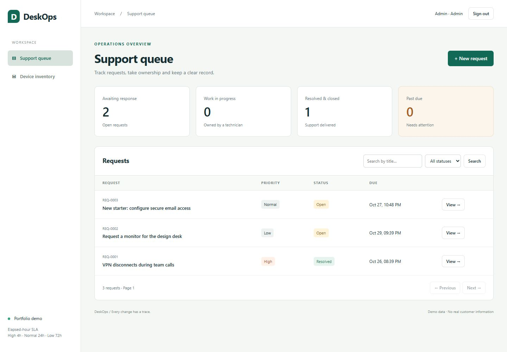

# DeskOps — IT Service Desk

A working C# portfolio application for the operational details that spreadsheet-based IT support misses: request ownership, device handovers, access boundaries and a reliable history of changes.

**ASP.NET Core 10 · EF Core · SQLite · Cookie authentication · xUnit**

[Architecture](docs/ARCHITECTURE.md) · [Verification](docs/VERIFICATION.md) · [API](docs/API.md)



## What to review in five minutes

1. Start the app and sign in as `admin@example.test`.
2. Open the overdue VPN request and take ownership. Resolve it with a concrete explanation, then close it.
3. Assign `LT-001` to Alex. Return it, assign it to Linh, and inspect the handover history.
4. Sign in as `alex@example.test`: only Alex's requests and currently allocated devices are visible.
5. Run the tests. Look at `Concurrent_handover_has_one_winner_and_one_active_assignment` and `Failed_audit_insert_rolls_back_ticket_creation` for the failure cases behind the UI.

All users and records are fictional. This is a portfolio release, not a production-ready service or evidence of paid work experience.

## Run locally

Install the **.NET 10 SDK**. No Node build, cloud account, API key or Docker is required for the SQLite demo.

```powershell
git clone https://github.com/ThanhVu90/-it-service-desk.git
cd ./-it-service-desk
dotnet restore ServiceDesk.slnx
$env:ASPNETCORE_ENVIRONMENT = 'Development'
$env:Demo__Seed = 'true'
$env:Demo__Password = Read-Host 'Choose a demo password of at least 12 characters'
dotnet run --project src/ServiceDesk --no-launch-profile --urls http://127.0.0.1:5080
```

Open **http://127.0.0.1:5080**. Alternatively, `./scripts/start-demo.ps1` prompts for a masked password and starts the app. Do not use a real account password for this demo.

On Bash:

```bash
read -rs -p 'Choose a demo password (12+ characters): ' Demo__Password; echo
export Demo__Password
ASPNETCORE_ENVIRONMENT=Development Demo__Seed=true dotnet run --project src/ServiceDesk --no-launch-profile --urls http://127.0.0.1:5080
```

| Account | Role | Allowed actions |
|---|---|---|
| `alex@example.test` | Employee | Own tickets, close own resolved tickets, own active device allocations |
| `linh@example.test` | Employee | Same rules, separate data boundary |
| `sam@example.test` | Technician | Read the queue, claim open tickets, resolve assigned tickets |
| `admin@example.test` | Administrator | Queue management and device registration/handovers |

The four seeded users share the password you choose. There is no embedded default password. Seeding only runs in Development/Testing and only on an empty user table. Re-running the app does not reset existing passwords. `desk.db` is created in the app's content directory. Preserve it to retain demo changes. Demo sessions expire after 30 minutes and are invalidated when the process restarts.

## Behavior worth inspecting

- **Object-level authorization:** list filters, dashboard totals, details and history honor the caller's data boundary; hiding a button is not the security mechanism.
- **Explicit workflow:** `Open → InProgress → Resolved → Closed`. Resolution requires notes. Only the requester or an administrator can close a resolved request.
- **Optimistic concurrency:** requests carry the version the user saw. Stale changes receive HTTP 409 instead of silently overwriting another person's work.
- **Database-enforced allocation rule:** a partial unique index permits only one active assignment per device. The application also checks this rule to provide a useful error.
- **Atomic audit history:** the mutation and audit entry commit together. A test injects an audit write failure and verifies the new ticket rolls back.
- **UTC deadlines:** high priority is 4 elapsed hours, normal 24 and low 72. This is intentionally not a business-hours/calendar SLA.
- **Browser protections:** password hashing, HttpOnly/SameSite cookies, antiforgery checks on mutations including login, login throttling, escaped user text and a restrictive content security policy.

## Build and test

```powershell
dotnet build ServiceDesk.slnx -c Release
dotnet test tests/ServiceDesk.Tests/ServiceDesk.Tests.csproj -c Release --logger trx
dotnet list src/ServiceDesk/ServiceDesk.csproj package --vulnerable --include-transitive
```

Tests use isolated, real SQLite files, not EF's in-memory provider. They exercise the HTTP pipeline with `WebApplicationFactory`. See the verification report for actual results and unverified areas. The CI workflow targets Windows and Linux; a workflow file alone does not prove a successful CI run.

## Upgrades, backups and restore

The SQLite schema is versioned with EF Core migrations. At startup the application reserves one of four bootstrap outcomes and never mixes them up:

| Outcome | When | What happens |
|---|---|---|
| `FreshMigrated` | Empty or brand-new database file | Applies every migration in order and seeds only when demo seeding is enabled |
| `AlreadyCurrent` | Migration history is present and complete | No schema work, no snapshot |
| `Migrated` | History present, newer migrations pending | Saves a safety snapshot, then migrates forward |
| `LegacyAdopted` | Tables exist but no migration history (pre-migration release) | Saves a snapshot, verifies the tables, columns and named indexes against the baseline migration, registers the baseline as applied, then upgrades |

If the existing schema does not match the baseline migration, startup **refuses to adopt**, leaves a data snapshot in `backups/` next to the database file, logs the path, and exits with an error instead of starting with a half-upgraded schema. Snapshots use the SQLite backup API (not a plain file copy), so they remain consistent even while the server is running, and each one passes an `integrity_check` before being kept. Deleting the database file is safe: a fresh one is recreated from migrations, nothing outside it holds schema state.

Backup and restore commands (no web app startup, no separate tooling):

```powershell
dotnet bin/Release/net10.0/ServiceDesk.dll db-backup  --source C:\path\desk.db --out C:\path\backups\desk-20261029.db
dotnet bin/Release/net10.0/ServiceDesk.dll db-restore --source C:\path\backups\desk-20261029.db --out C:\path\restored-copy.db
# then run with the restored copy:
ConnectionStrings__Desk = "Data Source=C:\path\restored-copy.db;Foreign Keys=True"
```

`./scripts/backup-desk.ps1 -Source <path>` builds nothing to cloud services and wraps the same commands (`-Restore` for restore, `-Build` to force a rebuild). Destinations must not already exist unless `--force` is passed, so snapshots are never silently replaced. Forward-only: rollbacks use a snapshot or backup file, not migration `Down` scripts, and `__EFMigrationsHistory` is protected by the audit-style guardrails above.

## Repository map

```text
src/ServiceDesk/
  Domain/       Entities, actor permissions and transition rules
  Data/         EF mapping, constraints, versioned migrations and explicit demo seed
  Services/     Use cases and transaction boundaries
  Program.cs    Authentication, HTTP endpoints and error mapping
  wwwroot/      Responsive UI without a frontend build toolchain
tests/ServiceDesk.Tests/  HTTP integration and domain tests
scripts/                 Local demo launcher
docs/                    Architecture and verification evidence
```

## Boundaries and next steps

The verified release uses SQLite. A PostgreSQL provider can be selected with `ConnectionStrings__Postgres`; it remains **experimental, still fed through `EnsureCreated` at startup, and not yet integration-tested** — it gets no migrations and no backup CLI until dedicated tests exist. Do not point this demo at an existing business database. Schema upgrades are forward-only for SQLite: a rollback means restoring a snapshot, and `git revert` of the application build does not downgrade a database.

Before production use: replace seeded users with a real provisioning/identity flow, implement account revocation/password recovery, review encryption and shared key storage, add PostgreSQL integration tests, configure trusted proxy handling and HTTPS, and schedule off-machine backups with retention. Migration adoption compares the visible schema only; row-level corruption is caught by the `integrity_check` after backup/restore, but content mismatches inside correct schema are out of scope. Audit rows are append-only through application code; they are not tamper-proof against a database administrator. Login throttling is per process and remote IP, not distributed. Asset inventory is currently unpaged, appropriate for the small demo only. No notification delivery, attachments, business calendar or uptime guarantee is claimed.

Developed with AI assistance.

