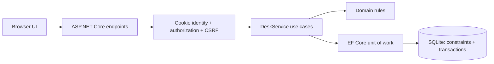
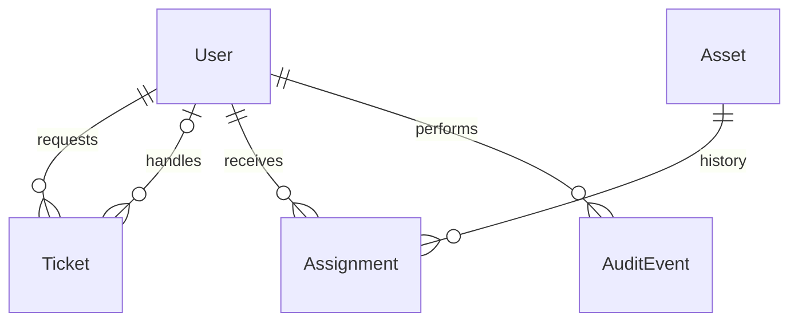

# Architecture and decisions

## Request path

A modular monolith keeps one deployable process and one database. Tickets, assets and identity have distinct responsibilities without paying the operational cost of microservices. Static HTML/CSS/JavaScript keeps the review setup small; endpoint requests remain authenticated and validated server-side.

## ADR 001 — Start with SQLite, retain a provider boundary

The reviewer should be able to run the project with one installed SDK. SQLite supports the foreign keys, unique index and transactions this demo needs. EF Core isolates provider configuration. A PostgreSQL configuration path exists, but provider equivalence must be established with integration tests before release. `EnsureCreated` is an empty-database demo bootstrap, not a schema migration strategy. We deliberately document this limit rather than pretend that switching providers proves production readiness.

## ADR 002 — Model workflow as allowed transitions

Open → InProgress assigns the caller. InProgress → Resolved requires the assignee or admin plus nonempty resolution notes. Resolved → Closed requires the requester or admin. All other transitions are rejected. The rule is centralized in `Rules.Transition`, so transport code does not invent its own workflow.

## ADR 003 — Use both friendly checks and durable constraints

Two requests can both observe an unassigned device. An application-level `AnyAsync` check alone cannot protect the invariant. The unique filtered index on `Assignments.AssetId WHERE ReturnedAt IS NULL` is authoritative. `Asset.Version` is also a concurrency token. A competing mutation returns a conflict; no auto-retry silently changes ownership.

Tickets use the same version strategy. A client version is checked before applying a transition, and EF includes the original version in the SQL update predicate. This protects against changes between read and save as well as visibly stale browser state.

## ADR 004 — Record audit events in the same transaction

Updates add the audit row before one `SaveChangesAsync`; EF supplies the transaction. Creates need a generated identity first, so they explicitly wrap both saves in a transaction. The failure-injection test forces the audit insert to fail and checks that ticket creation is rolled back.

`DeskDb` refuses modifications/deletions of audit entries through its async save path. There is no audit-edit endpoint. This is an application guarantee, not immutable external evidence or protection against direct SQL access.

## ADR 005 — UTC in storage; local display in the browser

EF converters restore the UTC kind when reading SQLite datetime values. JSON therefore includes `Z`; browsers convert to local time for display. Deadlines are elapsed hours. Weekends and office hours do not alter the calculation. Resolved/closed tickets are excluded from overdue totals.

## ADR 006 — Demo identity, explicit limits

PasswordHasher handles password verification. Roles originate in database-backed login, never a client-supplied field. Session cookies carry signed claims for up to 30 minutes. Development/Testing uses ephemeral protection for sessions, so restarts sign users out; a local key directory is also configured for framework key-ring initialization. Keys and databases are ignored by Git. Production needs an explicit shared, encrypted key store and real identity lifecycle. The current demo does not implement immediate revocation of already-issued cookies.

POST endpoints validate antiforgery tokens. Login is also protected. A fresh token is fetched after identity changes. A ten-per-minute login limiter is keyed by remote IP. Deployment behind a proxy requires explicit trusted proxy configuration; blindly trusting forwarded headers would weaken the limit.

## Data relationships

Important boundaries: employees cannot enumerate other employees' tickets through filters, totals or detail endpoints; technicians cannot assign/return assets; only admins can inspect full device handover histories and the recipient list.
